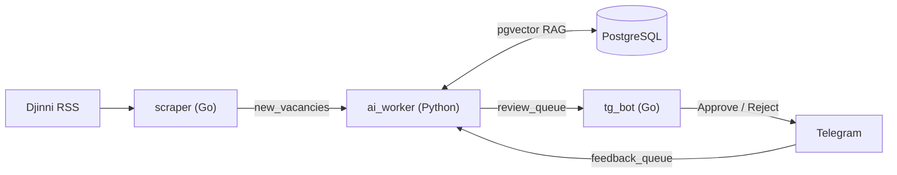

# Freelance Agent (`work-agent-bot`)

A personal automation pipeline that scrapes Djinni RSS vacancies, checks them against your project history in `pgvector`, drafts cover letters with Gemini, and sends them to Telegram for manual Approve/Reject review.

## How It Works



1. **`scraper` (Go):** Polls `DJINNI_RSS_URL`, deduplicates jobs in PostgreSQL (`jobs`), and publishes new ones to `new_vacancies`.
2. **`ai_worker` (Python):** Runs a 4-step `gemini-3.5-flash-lite` pipeline:
   - **Analyzer:** Scores the vacancy (0–100) using recent rejections from `user_feedback`, or skips it (`SKIP`).
   - **Validator:** Queries `code_embeddings` (`pgvector` HNSW, `gemini-embedding-001`) to match required skills against `candidate_profile.json`.
   - **Drafter & Critic:** Generates a short cover letter from verified facts and strips generic AI phrasing.
   - Publishes the result to `review_queue`. On startup, if `code_embeddings` is empty, it runs `index_knowledge_base()` automatically.
3. **`tg_bot` (Go):** Sends proposals to your Telegram chat with **Approve** / **Reject** buttons. Rejections are published to `feedback_queue` and saved in PostgreSQL for future runs.

## Stack

- **Go** (`scraper` 1.26, `tg_bot` 1.25): `gofeed`, `telebot.v4`, `amqp091-go`
- **Python 3.12** (`ai_worker`): `google-genai`, `pydantic`, `pika`, `psycopg2`
- **Infra:** PostgreSQL 16 + `pgvector`, RabbitMQ 4.3, Docker Compose

## Quickstart

1. Clone and configure `.env`:
   ```bash
   git clone https://github.com/ganfay/work-agent-bot.git
   cd work-agent-bot
   cp .env.example .env
   ```
   Fill in `PG_PASSWORD`, `GEMINI_API_KEY`, `TG_BOT_TOKEN`, `TG_USER_ID`, and `DJINNI_RSS_URL` in `.env`.

2. Update `candidate_profile.json` with your background and project snippets.

3. Run:
   - **Batch mode (recommended for laptops, 0 idle RAM):**
     ```bash
     make run-once
     ```
     Starts `db` and `rabbitmq`, runs `scraper` -> `ai_worker` -> `tg_bot` once (`RUN_ONCE=true`), waits briefly (`TG_POLL_GRACE=15s`) for any queued Telegram Approve/Reject clicks, then runs `docker compose down`.
   - **Always-on daemon mode:**
     ```bash
     make up
     ```

## Commands

```bash
make run-once       # Run one full batch cycle and tear down containers
make up             # Build and start all services in background
make down           # Stop all containers
make ps             # Check container status
make logs           # Tail all service logs (or logs-scraper / logs-ai / logs-bot)
make migrate-up     # Run PostgreSQL migrations
make index          # Re-index candidate_profile.json into pgvector
make clean          # Stop containers, remove volumes, and clear Python caches
```

## Author

Maksym Biesiedin ([@ganfay](https://github.com/ganfay))
